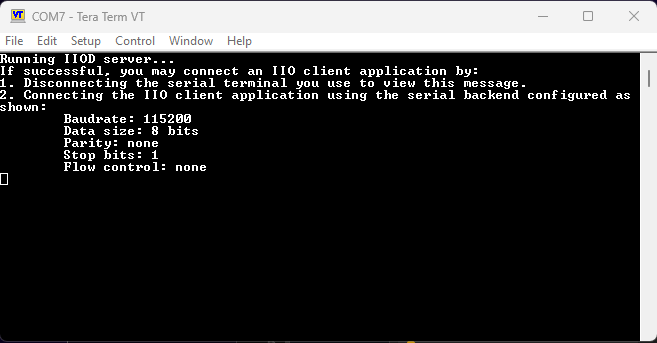

# MAX42500 examples — setup from a clean machine

How to go from a **laptop with nothing installed** to running the MAX42500
examples (the basic script and the GUI) against a Maxim MCU running the MAX42500
**no-OS IIO** firmware.

The setup has two sides:

```
  [ MCU board ]  AD-APARD32690-SL / MAX32655FTHR          [ Host laptop ]
  runs no-OS "iio_example" firmware  ──USB serial──►  pyadi-iio + libiio
  (TinyIIOD server over UART)        serial:COMx,115200,8n1n   examples / GUI
```

> **Important:** both host programs — the *basic* `max42500_example.py` **and**
> the GUI — are IIO clients. The MCU must run the no-OS **`iio_example`** variant
> (the TinyIIOD server). The no-OS **`basic`** variant is a standalone console
> demo and does **not** speak IIO, so the host scripts can't talk to it.

Commands below are **Windows PowerShell** (the tested environment); Linux/macOS
notes are called out where they differ.

---

## Part A — Install the required apps on the laptop (once)

| Tool | Needed for | Notes |
|---|---|---|
| **Python 3.8+** (3.11 tested) | everything host-side | Install from python.org. **Tick "Add to PATH"**, and keep the **tcl/tk** option (gives `tkinter`, required by the GUI). |
| **libiio runtime (0.25)** | pyadi-iio to talk to the board | The C library. On Windows, install the ADI **libiio 0.25** package or **IIO Oscilloscope** (bundles `libiio.dll` + `iio_info.exe`). |
| **git** | getting the pyadi-iio source | Or download the repo zip. |
| **uv** *(optional)* | faster installs | `pip install uv` or see astral.sh/uv. Speeds up Parts C. |
| **Analog Devices MSDK** *(only if you flash the firmware yourself)* | OpenOCD + ARM toolchain + target configs | Not needed if the board already has the IIO firmware. |

Verify the two essentials:

```powershell
python --version
& "C:\Program Files\IIO Oscilloscope\bin\iio_info.exe" --version   # expect "Libiio version: 0.25"
```

> On **Linux/macOS**: install libiio via your package manager (`apt install
> libiio-utils`, `brew install libiio`, …), check with `iio_info --version`, and
> make sure the pin in `requirements.txt` matches that version. On Linux also
> `sudo apt install python3-tk` for the GUI.

---

## Part B — Flash the no-OS IIO firmware to the MCU (step 1)

You need a board with a connected **SWD debug probe** (the AD-APARD32690-SL has
an onboard CMSIS-DAP debugger; the MAX32655FTHR needs an external one such as a
MAX32625PICO).

> **Flashing the MAX32655FTHR — use the Eclipse IDE (MSDK).** The old
> **drag-and-drop** method (copying a `.hex`/`.bin` onto the DAPLink
> mass-storage drive) **no longer works** on this board. Flash the `.elf` from
> the **MSDK Eclipse IDE** instead — import/open the project, then use its
> *Run/Debug* (OpenOCD) configuration to program the board. The OpenOCD command
> line in Option 1 performs the same flash if you prefer the terminal.
>
> **Which `.elf`?** For the host examples and the GUI you need the **IIO**
> firmware (`max42500-iio_example-...`) — that is the build that runs the TinyIIOD
> server pyadi-iio talks to. The `basic` build is a standalone console demo and
> does **not** speak IIO.

### Wiring — MAX32655FTHR ↔ MAX42500

Connect the MCU to the MAX42500 before flashing/running (in addition to the SWD
probe and the USB cable). The firmware drives the MAX42500 over **I²C2**, so
SDA/SCL must be wired too.

| MAX32655FTHR | MAX42500 | Purpose |
|---|---|---|
| 3V3 | VSUP | 3.3 V supply |
| GND | GND | common ground |
| P0_30 | SCL | I²C2 clock |
| P0_31 | SDA | I²C2 data |
| P1_6 | EN0 | enable / state-machine input 0 |
| P1_7 | EN1 | enable / state-machine input 1 |

> I²C2 runs at 400 kHz; the MAX42500 answers at bus address `0x28`. SDA/SCL need
> pull-ups to 3V3 (typically 2.2–4.7 kΩ) if the MAX42500 board doesn't fit them.

### Option 1 — flash a provided prebuilt `.elf` (fastest)

With the MSDK installed and the probe connected:

```powershell
$env:MAXIM_PATH = "C:\MaximSDK"
& "$env:MAXIM_PATH\Tools\OpenOCD\openocd.exe" `
    -s "$env:MAXIM_PATH\Tools\OpenOCD\scripts" `
    -f interface/cmsis-dap.cfg `
    -f target/max32690.cfg `
    -c "program max42500_iio.elf verify reset exit"
```

- Use the target cfg for your part: **`target/max32690.cfg`** for the
  AD-APARD32690-SL; **`target/max32655.cfg`** for the MAX32655FTHR.
- `max42500_iio.elf` is the prebuilt IIO firmware. Prebuilt MAX32655FTHR
  binaries are bundled in [`firmware files/`](firmware%20files/):
  - **IIO firmware — flash this one to run pyadi-iio / the GUI:**
    [`firmware files/max42500-iio_example-max32655fthr/build/max42500.elf`](firmware%20files/max42500-iio_example-max32655fthr/build/max42500.elf)
  - basic console demo (standalone, **not** an IIO server):
    [`firmware files/max42500-basic-max32655fthr/build/max42500.elf`](firmware%20files/max42500-basic-max32655fthr/build/max42500.elf)
  - each `build/` also has the matching `.bin` / `.hex` if your flasher prefers those.

### Option 2 — build and flash from no-OS source

From the `no-OS` repo (needs the MSDK; see its *Maxim CMake build guide*):

```powershell
$env:MAXIM_LIBRARIES = "C:\MaximSDK\Libraries"
cd C:\Users\aoesmer\git\max42500\no-OS

# build + flash the IIO firmware on the APARD32690
python tools/scripts/no_os_build.py build `
   --project max42500 --variant iio_example --board ad-apard32690-sl `
   --probe openocd --flash
```

Boards/variants available: `--board ad-apard32690-sl` (basic, iio_example) or
`max32655fthr` (iio_example). Always use `--variant iio_example` for these host
examples.

### After flashing

The board enumerates as a **USB serial (COM) port**. Note its number — that is
the `COMx` you pass to the host scripts. The TinyIIOD UART runs at **115200**
baud (both the AD-APARD32690-SL and the MAX32655FTHR), so the context URI is
`serial:COMx,115200,8n1n`.

> **MAX32655FTHR:** if **115200** does not work, try **57600** instead —
> `serial:COMx,57600,8n1n`.

### If the serial connection won't open

If a host script or `iio_info` can't establish the connection, confirm the IIOD
server is actually running first:

1. Open **Tera Term** on the board's **COM port** at **115200, 8 data bits, no
   parity, 1 stop bit, no flow control**.
2. Press the board's **reset** button. The terminal should print the IIOD banner:

   

3. **Close the serial terminal** (only one program can own the COM port at a
   time), then open a command prompt and query the context:

   ```powershell
   iio_info -u serial:COM7,115200,8n1n
   ```

   Replace `COM7` with your port. A device listing confirms the link; after that,
   the host examples in Part D will connect on the same URI.

---

## Part C — Set up pyadi-iio on the host (steps 2, 4, 5)

### 1. Get the source

```powershell
git clone https://github.com/analogdevicesinc/pyadi-iio.git
cd pyadi-iio
# (or use your existing checkout: C:\Users\aoesmer\git\max42500\pyadi-iio)
```

### 2. Create and activate a virtual environment named `env`

```powershell
python -m venv env
& .\env\Scripts\Activate.ps1
python -m pip install --upgrade pip
```

Linux/macOS: `python3 -m venv env && source env/bin/activate`.

### 3. Install the Python dependencies — **pin pylibiio first**

This is the step that avoids the errors we hit (see Troubleshooting). Installing
`pylibiio==0.25` **before** building pyadi-iio stops pip from pulling the broken
default `pylibiio 1.0`.

```powershell
pip install -r examples\max42500\requirements.txt
```

### 4. Build pyadi-iio from source (editable)

```powershell
pip install -e .
```

Use **editable** (`-e`) so edits to `adi/` and the examples take effect without
reinstalling. (`pip install .` also works but is a static copy.)

### Same thing with **uv** (faster)

```powershell
pip install uv                       # if not already installed
uv venv env
& .\env\Scripts\Activate.ps1
uv pip install -r examples\max42500\requirements.txt
uv pip install -e .
```

### 5. Verify the install

```powershell
python -c "import iio; print('libiio bindings', iio.version)"
python -c "import adi, serial; print('pyadi + pyserial OK')"
```

---

## Part D — Run the examples (step 6)

First, find the board's COM port:

```powershell
python -c "import serial.tools.list_ports as p; [print(x.device, x.description) for x in p.comports()]"
```

Then (venv activated), use `serial:COMx,115200,8n1n` — replace `COM4` below.

### Basic example (console)

```powershell
python examples\max42500_example.py serial:COM4,115200,8n1n
```

Configures VM1 and polls its OV/UV/OFF status once per second (Ctrl+C to stop).
If you pipe/redirect its output, run it unbuffered so lines appear live:

```powershell
python -u examples\max42500_example.py serial:COM4,115200,8n1n > log.txt
```

### GUI example

```powershell
python examples\max42500\max42500_gui\max42500_monitor_gui.py
```

Then type the URI in the **URI** box and press **Connect**. Or pass it (and,
optionally, enable the OpenArm bridge) on the command line:

```powershell
# prefill the URI
python examples\max42500\max42500_gui\max42500_monitor_gui.py serial:COM4,115200,8n1n

# also enable + point the OpenArm bridge at a file
python examples\max42500\max42500_gui\max42500_monitor_gui.py serial:COM4,115200,8n1n `
    --bridge C:\OpenArmBridge\system_state.json
```

The GUI renders fully **without** hardware (only Connect needs a board), so you
can inspect the layout anytime.

### Headless smoke test (no window)

Validates the IIO data path without opening the GUI — handy over SSH/CI:

```powershell
python examples\max42500\max42500_gui\_smoke_test.py serial:COM4,115200,8n1n
```

---

## Commands cheat-sheet

```powershell
# one-time host setup
python -m venv env
& .\env\Scripts\Activate.ps1
python -m pip install --upgrade pip
pip install -r examples\max42500\requirements.txt      # pylibiio 0.25 + numpy + pyserial
pip install -e .                                        # build pyadi-iio from source

# every new terminal
& .\env\Scripts\Activate.ps1

# run
python examples\max42500_example.py serial:COM4,115200,8n1n                 # basic
python examples\max42500\max42500_gui\max42500_monitor_gui.py              # GUI
python examples\max42500\max42500_gui\_smoke_test.py serial:COM4,115200,8n1n   # smoke test
```

---

## Troubleshooting (errors we actually hit)

| Symptom | Cause | Fix |
|---|---|---|
| `TypeError: argument of type 'NoneType' is not iterable` at `find_library("c")` on `import iio`, **or** `OSError: libiio version 1.x required` | pip installed **pylibiio 1.0** (libiio 1.x bindings); broken on Windows and wrong API for this pyadi | `pip uninstall -y pylibiio && pip install "pylibiio==0.25"` (match your libiio). Installing `requirements.txt` before `pip install -e .` prevents this. |
| `ModuleNotFoundError: No module named 'serial'` | `pyserial` missing (GUI) | `pip install pyserial` (it's in `requirements.txt`). |
| `Exception: No device found` on connect | wrong COM port, board not flashed/powered, wrong baud, or no hardware | Re-check the COM port (Part D), confirm the **iio_example** firmware is running, use `...,115200,8n1n`. Verify the IIOD server with the Tera Term + reset check ("If the serial connection won't open", Part B). |
| Can't connect to the MAX32655FTHR at 115200 | some units enumerate the TinyIIOD UART at a lower rate | try **57600**: `serial:COMx,57600,8n1n`. |
| `iio_info`/scripts can't open the port, or it looks busy | a serial terminal still owns the COM port | close Tera Term / any serial monitor — only one program can hold the port at a time — then retry. |
| Basic example connects but nothing prints when redirected | stdout is block-buffered when not a terminal | add `-u`: `python -u examples\max42500_example.py ...` |
| GUI opens but Connect fails with no board attached | expected | the GUI still renders fully; attach a board to connect. |
| `pylibiio` import works but attributes/channels missing | libiio C library vs bindings version mismatch | make `iio_info --version` and the `pylibiio==` pin agree. |
